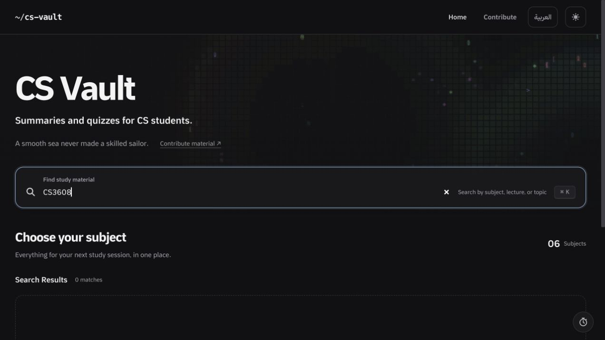
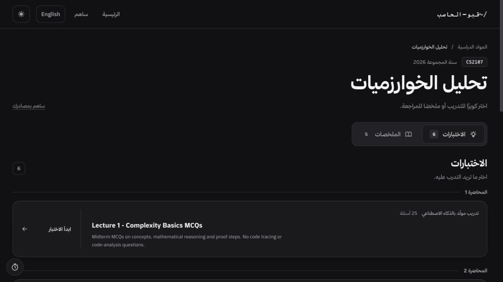

# ztest readiness review — 18 October 2026

Historical audit before the fixes. See the [foundation completion record](../foundation-ready.md)
for the implemented changes, current checks and deferred Form/team work.

Reviewed branch: `ztest`, commit `2da44ca`. Scope: the student site, content model,
quiz behavior, English/Arabic navigation, contribution intake, CI/deployment and
optional Python pipeline. Three review agents checked separate areas; the main
review also ran the full validation and exercised the local production build.

## Verdict

The architecture is a workable foundation for a **controlled Year 3 team pilot**.
Complete the intake setup, establish source review, and fix the first study-flow
defects below before inviting a large contributor group. A department-wide launch
is premature: the catalog only contains Year 3, Semester 1, and the contribution
process needs a summary path as well as its existing quiz path.

The owner confirmed that Year 3 comes first. Years 1, 2 and 4 remain deferred until
their official course lists and original teaching material are available.

This review adds documentation and evidence only. It does not fix application
code, update dependency versions, create live Google resources, recruit students,
publish content, merge branches, or start persistent AI workers.

## Current coverage and checks

| Course | Code | Summaries | Source quizzes | Questions |
| --- | --- | ---: | ---: | ---: |
| Algorithm Analysis | CS2107 | 5 | 5 | 125 |
| Computer Networks | CEN3011 | 0 | 0 | 0 |
| Engineering Software Products | CS3809 | 0 | 0 | 0 |
| Operating Systems | CS3608 | 2 | 3 | 60 |
| Programming Languages | CS3713 | 1 | 5 | 109 |
| Web Development | CS3810 | 4 | 8 | 160 |
| **Total** | | **12** | **21** | **454** |

These counts exclude the generated All Questions quizzes. All courses use
collection `2026`, `year_level: 3`, `semester: 1`.

- `npm run validate`: passed. Astro checked 59 files with zero errors/warnings;
  all 41 tests passed; 67 HTML pages built; local links, anchors and assets passed.
- Local browser: inspected the English home and Arabic subject/quiz layouts;
  verified course-code search failure and loss of summary selection on language
  switching. Practice answer feedback, next-question navigation and preservation
  of quiz position/options across Arabic → English worked.
- Focused source/VM reproductions confirmed aggregate identity, stale progress,
  timer settings, intake recovery and collection-rollover findings below.
- Contribution exports: all 15 regenerated files matched committed versions.
  SQLite schema/ingestion smoke checks ran in temporary storage.
- A basic scan of 133 tracked text files found no matches for common private-key,
  GitHub-token, AWS-access-ID or OpenAI-token patterns. This is a limited pattern
  check, not a guarantee that the repository contains no sensitive information.

The original lecture PDFs, exams and slides are absent from the repository.
All 454 questions have explanations and page/slide references, but 245 answers are
labeled inferred. Academic correctness cannot be certified without those sources.
Programming Languages tutorial question 22 explicitly describes a disputed key
([question and explanation](../../src/content/quizzes/programming-languages/2026/lecture-01-instructor-tutorial.json), lines 329–341).
Resolve that question with a human course reviewer before treating it as verified
scored practice; this audit does not choose a replacement answer.

Local execution used Node 25.7.0; configured GitHub Actions use Node 22. The initial
`node_modules` contained Windows native binaries and failed on macOS. A clean
locked `npm ci` restored the correct platform dependencies, after which validation
passed. The manifest and lockfile were unchanged.

## Launch gates

1. **Open and pilot intake.** [`contribution-config.ts`](../../src/data/contribution-config.ts),
   line 5, has an empty responder URL. Follow the existing
   [setup guide](../../contributions/google-apps-script/README.md): create/configure
   the Form, upload questions, private queue, team routing and reviewer file access.
   Test receipt, review, publication and correction before sharing the link widely.
2. **Add a summary handoff.** The current volunteer kit and queue are quiz-centric:
   `prepared_json_link`, `existing_quiz_url`, and Ready guidance requiring validated
   JSON ([Code.gs](../../contributions/google-apps-script/Code.gs), lines 5, 82–84).
   Add an artifact type (summary/quiz/both), Markdown draft/output links and a
   summary coverage/review checklist. The site already supports Markdown summaries;
   the missing piece is the contributor process.
3. **Assign people and evidence.** Name a Year 3 coordinator, course owners,
   independent human reviewers and a publisher. Obtain originals before producing
   more academic content. Empty Networks and Software Products cards need actual
   teaching scope and sources.
4. **Review dependency advisories before broader intake.** The current production
   dependency audit reports 11 affected packages: 1 critical, 9 high, 1 low.
   Astro is locked to 6.4.8. Its critical AVIF issue requires processing an
   attacker-controlled AVIF through the image service, as described in the
   [maintainer advisory](https://github.com/withastro/astro/security/advisories/GHSA-26w7-cxv4-gfx2).
   This site deploys static files; this finding does not establish remote code
   execution on the hosted pages. Review build-time exposure, upgrade in a separate
   tested change and rerun the audit. npm's suggested Astro repair crosses a major
   version; do not apply a blind forced update.

## Confirmed defects to fix for the Year 3 pilot

Priority P2 means a functional defect worth fixing in the pilot; P3 is lower urgency.

| Priority | Finding and reproducible impact | Source | Recommended change |
| --- | --- | --- | --- |
| P2 | **Summary progress can be lost.** Two pages load the same empty progress. Arabic marks summary one; cached English returns showing 0%. Marking summary two from English replaces storage with only summary two. | [subject-dashboard.ts](../../src/scripts/subject-dashboard.ts), lines 89–103, 132–146; its `pageshow` handler refreshes scores only. | Reload progress on `pageshow`/`storage`, repaint checkboxes and reconcile the stored state before each mutation. |
| P2 | **Course-code searches fail.** Enter `CS3608`, `CS3810` or `CS2107`, which appear on course cards: zero matches. Reproduced in the browser and both built search indexes. | [HomePage.astro](../../src/components/pages/HomePage.astro), lines 52, 63, 78; [home.ts](../../src/scripts/home.ts), lines 119–124. | Index the actual catalog code plus English/Arabic names separately. |
| P2 | **All Questions can discard distinct code questions.** Two valid questions with matching wording/options/answer but different `code` yield one aggregate question. Case-sensitive answers `total` and `TOTAL` also collapse. This is a reproduced input scenario, not a claim that today's bank already lost those questions. | [quiz-routes.ts](../../src/lib/quiz-routes.ts), lines 17–23. | Include code in identity and preserve meaningful case/whitespace. Check conflicting answers separately. |
| P2 | **Combined questions lose document provenance.** A copied question retains a page number while the aggregate replaces the source filename with generic text. Programming Languages combines three PDFs, so a page reference alone is ambiguous. | [quiz-routes.ts](../../src/lib/quiz-routes.ts), lines 26–29, 38. | Retain source quiz ID, original question ID and filename on each combined question; offer a link to the originating quiz. |
| P2 | **Break settings reset the active study timer.** With 15 minutes of study remaining, changing break length from 10 to 15 jumps the study timer to 50 minutes. Verified with the actual script in a VM. | [pomodoro.ts](../../src/scripts/pomodoro.ts), lines 153–156. | Update only the edited phase's duration; preserve the running phase when editing the other one. |
| P3 | **Switching language loses the selected summary.** Select Algorithm Analysis lecture 5, then العربية: the Arabic page opens its default quizzes panel. Browser-confirmed. | [Layout.astro](../../src/layouts/Layout.astro), line 113. | Carry the current URL fragment into the translated route client-side. |
| P3 | **Summary heading IDs collide.** EN and AR Algorithm Analysis each contain five `midterm-focus` IDs; that fragment resolves to lecture 1 regardless of the intended lecture. The link checker does not detect duplicate IDs. | [SubjectPage.astro](../../src/components/pages/SubjectPage.astro), lines 282–283; [subject-dashboard.ts](../../src/scripts/subject-dashboard.ts), line 267. | Namespace Markdown heading IDs and local fragment links with their summary slug. |
| P3 | **Original answer letters conflict with shuffled labels.** All 29 instructor-tutorial explanations retain original PDF letters. Fortran can appear as D while its explanation says the key selects A. Text-based scoring remains correct. | [tutorial question 3](../../src/content/quizzes/programming-languages/2026/lecture-01-instructor-tutorial.json), line 53; [quiz.ts](../../src/scripts/quiz.ts), lines 183–200. | Say “original PDF choice A” or remove original option letters from explanations. |

Search evidence:

Language-switch evidence: after selecting lecture 5's summary, the Arabic route has
no fragment and the quizzes panel is active.

## Intake and pipeline defects for expansion

| Priority | Finding and verification | Source | Recommended change |
| --- | --- | --- | --- |
| P2 | **Reconciliation can repeatedly miss the tail.** Every run starts at the oldest response and stops after 240 seconds without a cursor. A timed mock with 250 responses repeatedly attempted 0–239 and never reached missing response 249. Each response also rereads the full Queue. | [Code.gs](../../contributions/google-apps-script/Code.gs), lines 120–125, 137–140. | Read existing IDs once, use resumable bounded batches and preserve retry state for failed responses. |
| P2 | **A second collection breaks old response labels.** `CS3608 — Operating Systems — Year 3` resolves with 2026 alone; adding the 2027 edition changes both current labels and makes the old label resolve to no course. Recovered old responses go to triage. | [Code.gs](../../contributions/google-apps-script/Code.gs), lines 184–189, 204–209. | Use stable course keys from the beginning and retain historical label mappings. |
| P2 | **Exported course choices are ambiguous across collections.** The exported 2026/2027 labels are identical, whereas Apps Script adds collection years. | [course-catalog.ts](../../src/lib/course-catalog.ts), line 9; [export-contribution-kit.mjs](../../scripts/export-contribution-kit.mjs), line 15. | Share one stable choice/key contract across generated files and intake. |
| P3 | **Ingestion preserves stale skipped paths.** Import `document.tmp`, rename the same bytes to `document.pdf`, then import again: the row stays skipped and points to the removed `.tmp` path. | [ingest.py](../../pipeline/pipeline/ingest.py), lines 59–73. | Refresh location metadata on hash conflicts and allow a supported retry for noncommitted sources. |

The optional Python pipeline currently creates a database and registers PDFs/images.
It does **not** extract, verify or export questions. Its documentation states this
correctly. Use the manual author/reviewer process for the pilot; automatic content
production requires additional implementation and source review.

## Design and learning-flow improvements

- Keep the shared page components, restrained course cards, separate quiz/summary
  modes, visible source categories and content-language direction. The inspected
  desktop English/Arabic pages give a coherent starting point; a visual redesign
  is unnecessary for the pilot.
- Add “Review saved mistakes” with a due count. The site stores scheduled mistakes
  ([quiz.ts](../../src/scripts/quiz.ts), lines 42–54, 260–262), but no UI calls
  `shortReview` or offers a saved due-question session. Current retry works only
  from the current attempt's results.
- Introduce explicit lecture/chapter/order metadata. Sorting currently includes
  an eight-item Web Development filename list and grouping parses English titles
  ([SubjectPage.astro](../../src/components/pages/SubjectPage.astro), lines 54–113).
  This becomes inconsistent as independent course teams choose titles.
- Preserve the selected study-year tab in the URL. When adding empty early-year
  courses, choose the initial tab from courses with material: the current default
  uses every catalog course despite its “first year with content” comment
  ([HomePage.astro](../../src/components/pages/HomePage.astro), lines 42–44).
- Show collection year on cards when multiple editions exist and resolve names
  by course key. Cards currently omit it; `getSubjectName` selects the first
  matching slug/name without a year ([modules.ts](../../src/lib/modules.ts), line 9).
- Normalize heading hierarchy: all 50 quiz pages lack an `h1`; two Web Development
  summaries add top-level headings inside a subject page that already has one.
  Use one page heading and subordinate content headings. Arabic-authored mistake
  cards also need content direction instead of `dir = 'ltr'`
  ([quiz.ts](../../src/scripts/quiz.ts), line 247).
- Add focused browser regression coverage for code search, summary language/deep
  links, progress across tabs/cached Back, timer settings and exam expiry/resume.
  Preserve the existing state/schema tests; they are useful but did not catch
  the integration defects above. Require the existing validation check in branch
  protection before merge; remote branch settings were not inspected here.

Current page size is modest: the largest built quiz is about 133.5 KB raw and
29.2 KB in a gzip simulation. Whole-site HTML totals 3.26 MB across 67 pages.
Do not add a database/backend solely for scale yet. Revisit loading/search
strategy after measuring real content growth; all summaries currently render
within each subject page, and both languages contain the same study material.

## Concrete Year 3 start

Use the [Year 3 volunteer charter and backlog](../../contributions/teams/year-3.md)
and [AI helper prompts and handoffs](../../contributions/teams/ai-workflow.md).
Assignments are deliberately unassigned until students accept them. The prompts
are reusable instructions, not running background agents.

Start with Operating Systems Chapter 1: retain the original source, independently
check its existing summary and 20-question quiz, resolve findings, validate, and
exercise one publication and correction. Then expand lecture by lecture across
the six Year 3 courses. Add another academic year only after its curriculum and
sources are registered and this process works end to end.

Evidence files: [validation output](assets/ztest-validation.txt) and
[npm production dependency audit](assets/ztest-dependency-audit.json).
Live Form/Drive access, actual GitHub Actions results, branch protection, original
source accuracy and physical mobile-device rendering were not verified.
